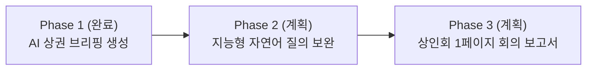

# 제주 주말소비 (Jeju Weekend Data) AI 기반 서비스 개선 및 확장 계획서

본 문서는 [PRD.md](file:///c:/Users/jangd/OneDrive/바탕%20화면/jproject/PRD.md)의 핵심 목표(소상공인 및 상인회의 주말 소비 의사결정 지원)를 고도화하기 위해 구글 **Gemini API**를 활용한 인공지능 기반 서비스 기능 현황과 단계별 개선 로드맵을 정의합니다.

---

## 1. 추진 배경 및 목표

- **핵심 목표**: 제주데이터허브 608번(토/일 카드 결제 건수)의 정량적 통계 수치를 소상공인과 상인회 담당자가 즉시 매장 운영, 재고 관리, 주말 마케팅에 적용할 수 있는 **정성적 실천 인사이트(Actionable Insight)**로 변환합니다.
- **활용 모델**: `gemini-flash-lite-latest` (안정적 초고속 응답, 필요 시 `gemini-3.8-flash` 자동 폴백)

---

## 2. 현재 구현 완료 내역 (Phase 1: AI 상권 브리핑)

1. **실제 Gemini API 키 연동 완료**:
   - `.env`에 `GEMINI_API_KEY` 설정 및 키 유효성 검증 완료.
   - `lib/gemini.ts`의 `getGeminiApiKey()`로 안전한 키 로딩 및 다중 후보 모델 순차 폴백 메커니즘 구축.
2. **AI 상권 분석 API 엔드포인트 ([app/api/ai/insight/route.ts](file:///c:/Users/jangd/OneDrive/바탕%20화면/jproject/app/api/ai/insight/route.ts))**:
   - `POST /api/ai/insight`
   - 지역, 관광객 유형, 기간, 토/일 건수, 차이 데이터를 프롬프트로 가공하여 2~3문장의 명확한 한국어 운영 제언 생성.
   - `hasSameOrigin` CSRF 방어 및 API 키 누락 시 안전한 에러 핸들링.
3. **대시보드 UI 연동 ([components/weekend-dashboard.tsx](file:///c:/Users/jangd/OneDrive/바탕%20화면/jproject/components/weekend-dashboard.tsx))**:
   - 비교 결과 영역 하단에 `GEMINI AI 상권 브리핑` 카드 추가.
   - 클릭 한 번으로 해당 조건의 맞춤형 조언(재고 준비, 양일 프로모션 등)을 즉시 확인 가능.

---

## 3. 단계별 AI 서비스 개발 및 개선 로드맵

### 📍 Phase 2: 지능형 자연어 질의 보완 (AI Query Refinement & Fallback)
- **개념**: 규칙 기반 인터프리터(`lib/jeju/aggregate.ts`)가 해석하기 어려운 모호한 질의나 구어체 입력 시 Gemini가 의도를 파악하여 적절한 필터 조건을 추천합니다.
- **예시 케이스**:
  - 사용자 입력: *"주말에 사람 제일 많이 몰렸던 달 알려줘"*
    → Gemini 분석: 2016-09 ~ 2017-11 전 기간 제주시 내국인 토·일 최대 건수 월(2017년 5월) 필터 자동 추천.
  - 사용자 입력: *"서귀포는 어떵?"* (제주 방언/구어체)
    → 직전 조건 승계 + 지역을 '서귀포시'로 파싱하여 실행 제안.
- **구현 방식**:
  - 규칙 기반 파싱 실패 시, Gemini JSON Mode를 호출하여 `{ districtType, userType, startMonth, endMonth, explanation }`을 반환받아 화면에 '추천 검색' 칩으로 제안.

### 📍 Phase 3: 상인회 정기 회의용 주말 상권 요약 보고서 (Merchant Meeting Report Export)
- **개념**: 상인회 담당자가 구도심 상인회 정기 총회나 회의에서 바로 활용할 수 있도록 1페이지 분량의 주말 상권 동향 리포트를 자동 생성합니다.
- **주요 기능**:
  - 기간별(분기/반기/연간) 토요일 vs 일요일 소비 격차 요약.
  - 내국인 수요와 중국인 관광객 수요의 주말별 패턴 차이 대조 브리핑.
  - 마크다운 및 인쇄용 친화적(Print-friendly) 서식 제공.

---

## 4. 보안 및 운영 가이드

- **API 키 보호**: 실제 API 키는 Git에 커밋되지 않도록 `.env`에 격리되어 있으며, 클라이언트 응답이나 공개 로그에 절대 노출되지 않습니다.
- **장애 대응 (Graceful Degradation)**:
  - Gemini API 호출 실패(할당량 초과, 네트워크 지연 등) 시에도 핵심 통계 및 막대 차트는 정상적으로 표시됩니다.
  - AI 브리핑은 부가 가치(Enhancement)로 동작하여 전체 서비스 가용성에 영향을 주지 않습니다.
