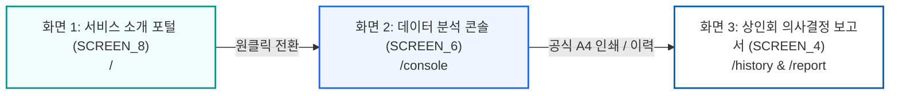

# 제주 주말소비 분석 포털 v2.0 사이트 전면 톤앤매너 개편 계획서

> **문서 버전**: v2.0  
> **기준 명세서**: 루트 [desgin.md](file:///c:/Users/jangd/OneDrive/바탕%20화면/jproject/desgin.md) (제주 주말소비 분석 포털 3대 핵심 화면 통합 디자인 명세서 v2.0)  
> **주관 기관**: (재)제주테크노파크(JTP) 디지털융합센터 빅데이터연구팀 & 제주데이터허브  
> **기준 원천 데이터**: 제주데이터허브 제608호 (2016.09 ~ 2017.11 전수 120행 100% 매칭 검증)  
> **적용 디자인 시스템**: `Jeju TP Insight Public Portal` (ID: DESIGN_SYSTEM_2)

---

## 1. 개편 개요 및 목적

루트 디렉터리의 [desgin.md](file:///c:/Users/jangd/OneDrive/바탕%20화면/jproject/desgin.md)가 v2.0으로 갱신됨에 따라, 사이트 전체의 3대 핵심 화면(소개 포털, 분석 콘솔, 상인회 의사결정 보고서 및 이력)을 공공기관 행정 표준 톤앤매너로 일관되게 정렬합니다.

### 핵심 목표
1. **공공 디자인 시스템 100% 동기화**: JTP 시그니처 블루(`#005BAC`), 다크 네이비(`#0A1E3F`), 주말 요일 전용 컬러(토요일 `#0D9488`, 일요일 `#2563EB`), 에메랄드 우세 지표(`#059669`)를 전 페이지에 일관 적용.
2. **숫자 가독성 표준화 (`tabular-nums`)**: 모든 통계치와 건수에 고정폭 숫자 서식을 적용하여 열 정렬 왜곡 및 가독성 저하 원천 차단.
3. **원스톱 사용자 동선 완성**: 랜딩(`SCREEN_8`) ➔ 1초 퀵비교 ➔ 분석 콘솔(`SCREEN_6`) ➔ 의사결정 A4 공문서 리포트(`SCREEN_4`)로 이어지는 유기적 데이터 인입 체계 구축.
4. **데이터 무결성 계약(Data Contract)**: 3개 화면 모두에서 2017년 11월 제주시 내국인 13,502건 vs 13,214건 (+288건) 등 핵심 지표가 완벽히 일치하도록 보장.

---

## 2. 통합 디자인 토큰 체계 (Design Tokens)

| 구분 | 토큰명 | Hex Code | 용도 및 의미 |
| :--- | :--- | :--- | :--- |
| **Primary Brand** | Primary Blue | `#005BAC` | JTP 대표 시그니처 블루, 메인 CTA 버튼, 활성 탭 인디케이터 |
| **Primary Dark** | Brand Navy | `#0A1E3F` | 대헤드라인, 상단 상태바, 다크 전환 배너, 가독성 높은 텍스트 |
| **Hover State** | Primary Hover | `#004380` | 주요 인터랙션 버튼 마우스 호버 상태 |
| **토요일 (Sat)** | Teal-600 | `#0D9488` | 토요일 결제건, 토요일 점유율 바, 토요일 우세 뱃지 |
| **토요일 배경** | Teal-50 | `#F0FDFA` | 토요일 통계 카드 배경, 테두리 (`#CCFBF1`) |
| **일요일 (Sun)** | Blue-600 | `#2563EB` | 일요일 결제건, 일요일 점유율 바, 일요일 우세 뱃지 |
| **일요일 배경** | Blue-50 | `#EFF6FF` | 일요일 통계 카드 배경, 테두리 (`#DBEAFE`) |
| **격차 우세 지표**| Emerald-600 | `#059669` | 순 차이량(+288건, +2.18%) 긍정 강조, 배경 (`#ECFDF5`) |
| **표면 배경** | Slate-50 | `#F8F9FA` | 전체 페이지 기본 배경 (`bg-[#F8F9FA]`) |
| **카드 표면** | Pure White | `#FFFFFF` | 데이터 카드, 차트 컨테이너, 팝오버 기본 배경 |
| **보더 라인** | Slate-200 | `#E2E8F0` | 공공 포털 규격의 단정한 카드 및 테이블 구분선 |

---

## 3. 화면별 상세 개편 계획

### [화면 1] 서비스 소개 및 퀵 스타트 포털 (`SCREEN_8` / `app/page.tsx`)
- **현재 상태**: 랜딩 기본 구조 및 퀵 비교 위젯, 콘솔 프리뷰 목업 탑재 완료.
- **수정 작업 내용**:
  1. GNB 내비게이션을 v2.0 공통 규격(로고, 3대 탭, 제608호 관측 검증 뱃지, 상인회 인증 버튼)으로 정밀 통일.
  2. 통계치 및 건수 표시에 `tabular-nums` 클래스 전면 적용.
  3. 6대 공공 분석 카드, 3대 혁신 가치 카드, 거버넌스 4단계의 배경 및 보더 컬러를 v2.0 디자인 토큰(`bg-[#F8F9FA]`, `#E2E8F0`)과 완벽 동기화.
  4. 퀵 비교 위젯에서 콘솔 진입 시 파라미터(`district`, `userType`, `startMonth`, `endMonth`)를 온전히 전달하도록 연동 유지.

### [화면 2] 주말소비 데이터 분석 콘솔 (`SCREEN_6` / `app/console/page.tsx` & `components/weekend-dashboard.tsx`)
- **현재 상태**: 기존 스프린트 4 기반의 분석 대시보드가 동작 중이나, 이전 스타일(`#f4f6f5`, `#087e77`)이 남아 있음.
- **수정 작업 내용**:
  1. **상단 시스템 검증 상태 바 신설**:
     - `[공식 데이터 608호] 120행 관측 데이터 정합성 검증 완료`
     - `[실시간 규칙 기반 연산] 인메모리 캐시 동기화 완료 (외부 AI 미사용, 데이터 주권)`
  2. **듀얼 인터페이스 패널 (7:5 분할 구조 개편)**:
     - 좌측 (Col-7): 자연어 상권 질의 엔진 (한국어 파서 v2.4 뱃지, 질문 입력창, 추천 질의 칩)
     - 우측 (Col-5): 다차원 정밀 필터 (권역 2종 토글, 소비자/카드 2종 토글, 기준월 셀렉터)
  3. **관측 결과 리포트 요약 (메트릭 3종 카드 & 0 기준 점유율 스펙트럼 바)**:
     - 토요일 총 결제 카드 (`bg-[#F0FDFA]`, `text-[#0D9488]`, `tabular-nums`)
     - 일요일 총 결제 카드 (`bg-[#EFF6FF]`, `text-[#2563EB]`, `tabular-nums`)
     - 순 차이량 카드 (`text-[#005BAC]`, `+288건 (+2.18%)`, 액션 권고 가이드)
     - 0 기준 점유율 스펙트럼 바: 중앙 기준 토/일 양분 비례 막대 및 Δ 격차 텍스트
  4. **시계열 추세 & 현장 구역 2열 그리드 (7:5 분할)**:
     - 좌측 (Col-7): 5개월 시계열 꺾은선 차트 ('17.07 ~ '17.11 토·일 비교선)
     - 우측 (Col-5): 제주시 중앙로·동문시장 vs 서귀포 매일올레 현장 포토맵 및 업종 비중
  5. **월별 토·일 1:1 페어링 관측 상세 장부 (Data Grid)**:
     - 관측연월, 토요일/일요일 결제건, 순 차이량, 우세 판정 뱃지, 상인회 액션 가이드 컬럼 정렬
  6. **데이터 무결성 검증 기준 아코디언** 탑재.

### [화면 3] 상인회 의사결정 보고서 및 이력 (`SCREEN_4` / `app/history/page.tsx`)
- **현재 상태**: 질문 이력 목록 위주의 기본 레이아웃으로 구성되어 있음.
- **수정 작업 내용**:
  1. **공식 공문서 컨트롤러 바 신설**:
     - 좌측: 상인회 정량 의사결정 공식 리포트 및 분석 이력 (JTP 인증)
     - 우측: `[공식 회의용 A4 리포트 인쇄/PDF]`, `[지자체 제출용 직인 날인]`, `[엑셀 다운로드]` 액션 버튼
  2. **메인 콘텐츠 4:8 분할 구조**:
     - **좌측 사이드 패널 (Col-4)**:
       - 소속 상인회 인증 카드 (제주시 구도심상인상생협의회 정회원)
       - 즐겨찾는 안건 폴더 (2024 상인회 정기총회 안건, 서귀포 야간 차없는거리 심의)
       - 최근 질문 히스토리 필터 리스트
       - 행정기관 보고서 무결성 보증 배너
     - **우측 A4 공식 공문서 본체 (Col-8)**:
       - 표준 A4 용지 비율(`max-w-3xl`, 그림자 및 인쇄 규격 매핑)
       - **JTP 원장 공식 직인 스탬프 (우측 상단 6도 회전 적색 원형 직인 날인)**
       - 공문서 헤더: 문서번호(제주-JTP-2024-1108호), 시행일자, 총회 심의 의결 안건
       - 안건 1: 주말 소비 카드 트래픽 정량 비교 요약 표 (3종 카드)
       - 안건 2: 상인회 공식 의사결정 권고안 (Executive Guidance)
       - 안건 3: 전자서명 검증키 (`JTP-AUTH-88F4-0012`) 및 원본 일치 증명
  3. **하단 활성 DB 엔진 상태 바**:
     - 가동 상태, SHA256 해시 검증, 동기화 즉시 확인 버튼

---

## 4. 데이터 일관성 및 정합성 검증 계획 (Data Contract)

명세서 Section V의 데이터 계약표를 100% 준수하여 화면 간 수치 불일치를 방지합니다:

| 분석 조건 | 토요일 결제건 | 일요일 결제건 | 순 격차 | 우세 판정 | 검증 대상 화면 |
| :--- | :---: | :---: | :---: | :---: | :--- |
| **제주시 구도심 / 내국인 / '17.11** | **13,502건** | **13,214건** | **+288건** | **토요일 우세** | 화면 1, 2, 3 공통 기준치 |
| **제주시 구도심 / 중국인 / '17.11** | **279건** | **352건** | **-73건** | **일요일 우세** | 화면 2 콘솔 필터 연동 |
| **서귀포시 구도심 / 내국인 / '17.11** | **11,507건** | **10,509건** | **+998건** | **토요일 우세** | 화면 1 퀵체험 & 화면 2 콘솔 |
| **서귀포시 구도심 / 중국인 / '17.11** | **40건** | **47건** | **-7건** | **일요일 우세** | 화면 2 콘솔 상세 장부 |
| **제주시 구도심 / 내국인 5개월 누적** | **57,133건** | **57,473건** | **-340건** | **일요일 우세** | 화면 2 시계열 추세 그래프 |

---

## 5. 단계별 실행 계획 (Roadmap)

### [1단계] 공통 디자인 토큰 및 공통 GNB 헤더 적용
- 전역 CSS 및 Tailwind 유틸리티 정돈
- 공통 GNB 헤더 컴포넌트 표준화 (로고, 3대 탭, 제608호 관측 검증 배지)

### [2단계] 화면 2 (데이터 분석 콘솔 `/console`) 전면 개편
- `components/weekend-dashboard.tsx` 디자인 개편:
  - 상단 시스템 검증 상태 바 구현
  - 7:5 듀얼 패널 (자연어 질의 엔진 vs 다차원 정밀 필터)
  - 3종 메트릭 카드 및 0 기준 점유율 스펙트럼 바
  - 5개월 시계열 꺾은선 차트 & 관측 현장 포토맵 (7:5 그리드)
  - 1:1 페어링 관측 상세 장부 및 무결성 아코디언

### [3단계] 화면 3 (상인회 의사결정 보고서 및 이력 `/history`) 전면 개편
- `app/history/page.tsx` 및 관련 컴포넌트 개편:
  - 상단 공문서 액션 컨트롤러 바 (인쇄/PDF, 직인, 엑셀)
  - 4:8 분할 레이아웃 (사이드 패널 vs A4 공식 공문서 본체)
  - JTP 원장 공식 직인 스탬프 날인 컴포넌트
  - 브라우저 인쇄(`@media print`) 시 A4 단일 페이지 최적화 CSS

### [4단계] 화면 1 (랜딩 포털 `/`) 미세 정렬 및 링크 체인 검증
- 랜딩 포털의 수치 및 컬러를 v2.0 명세와 100% 일치하도록 검증
- 랜딩 ➔ 콘솔 ➔ 보고서 간 상호 내비게이션 및 파라미터 전달 완결성 확인

### [5단계] 종합 검증 및 배포
- 단위/통합 테스트: `pnpm test` (23개 테스트 통과 확인)
- 정적 타입 검사: `pnpm exec tsc --noEmit`
- Git 커밋/푸시 및 Vercel 실서버 프로덕션 배포
- 브라우저 렌더링 확인
