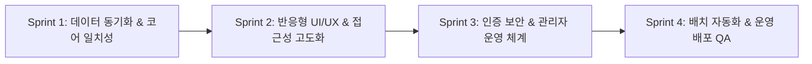

# 제주 주말소비 (Jeju Weekend Data) 개발 계획서

본 문서는 루트 경로의 [PRD.md](file:///c:/Users/jangd/OneDrive/바탕%20화면/jproject/PRD.md)에 명시된 요구사항과 성공 조건을 충실히 이행하기 위해 수립된 스프린트 단위의 상세 개발 계획서입니다.  
프로젝트의 현재 구현 현황을 면밀히 분석하고, 남아있는 기능적·비기능적 갭을 해소하여 안정적인 프로덕션 배포 및 운영을 달성하는 것을 목표로 합니다.

---

## 1. 프로젝트 개요 및 목표

### 1.1 프로젝트 목적
- **목표**: 제주시·서귀포시 구도심 소상공인 및 상인회 담당자가 [제주데이터허브 608번](https://jejudatahub.net/data/view/data/608) 공공 데이터를 활용하여 **토요일과 일요일의 카드 결제 건수**를 직관적으로 비교·분석할 수 있도록 지원합니다.
- **핵심 가치**: 원자료에서 복잡하게 요일별 관측치를 일일이 대조할 필요 없이, 한국어 자연어 질문 또는 직관적인 필터 선택을 통해 의사결정의 근거(요일별 건수, 차이, 포함/제외 월 및 사유)를 한눈에 파악할 수 있도록 합니다.

### 1.2 핵심 지표 및 데이터 스코프
- **분석 지표**: 카드 결제 건수 (단위: 건, 금액이 아닌 건수 기준)
- **공식 수집 기간**: `2016-09` ~ `2017-11` (총 15개월)
- **분석 대상**:
  - 지역: 제주시 구도심, 서귀포시 구도심
  - 관광객 유형: 내국인, 중국인 관광객
- **MVP 제외 범위 (Scope Out)**:
  - 인앱 결제/유료 구독 기능
  - 매출액/건당 평균 결제액 분석
  - 세부 업종, 개별 가맹점, 연령대, 시간대별 분석
  - 실시간 결제 현황 조회 및 미래 소비 예측 AI 모델

---

## 2. 현황 분석 및 PRD Gap 분석 (해결 현황)

현재 코드베이스는 총 22개의 단위 테스트([tests/jeju-question.test.mjs](file:///c:/Users/jangd/OneDrive/바탕%20화면/jproject/tests/jeju-question.test.mjs), [tests/jeju-import.test.mjs](file:///c:/Users/jangd/OneDrive/바탕%20화면/jproject/tests/jeju-import.test.mjs), [tests/jeju-consistency.test.mjs](file:///c:/Users/jangd/OneDrive/바탕%20화면/jproject/tests/jeju-consistency.test.mjs), [tests/jeju-auth-admin.test.mjs](file:///c:/Users/jangd/OneDrive/바탕%20화면/jproject/tests/jeju-auth-admin.test.mjs))를 100% 통과하고 있으며, PRD에서 도출되었던 갭들이 스프린트 1~4를 거쳐 모두 해소되었습니다.

| 영역 | 초기 상태 및 Gap | 개선 및 구현 결과 | 상태 |
| :--- | :--- | :--- | :---: |
| **데이터 동기화** | 클라이언트가 정적 JSON만 조회하여 관리자 DB 버전 미반영 | `readDataset()` 저장소 파이프라인과 `/api/compare`를 구축하여 DB 활성 버전을 우선 반영하고 무중단 정적 폴백 연동 | ✅ 완료 |
| **질문 이력 재조회** | `?replay=...` 시 정적 데이터 고정 및 인텐트 손실 | 세션 사용자 본인 이력 격리 조회(`user.id`), 활성 DB 기준 재집계, 인텐트(`availability`, `monthly`) 온전 복원 | ✅ 완료 |
| **화면 반응형/접근성** | 390px 모바일 가독성 및 스크린리더 미흡 우려 | 390px 뷰포트 레이아웃 최적화, 한글 IME 조합 중 Enter 방지, ARIA `progressbar`/`role="alert"` 속성 완비 | ✅ 완료 |
| **인증 및 권한 통제** | 비인가 사용자의 `/admin` 및 CSRF 방어 점검 필요 | `ADMIN_EMAILS` 기반 RBAC 검증, `hasSameOrigin` 헤더 검증, 이력 데이터 사용자 격리 완료 | ✅ 완료 |
| **운영 갱신 및 배포** | 갱신 실패 시 롤백 및 에러 사유 마스킹 필요 | 트랜잭션 기반 롤백, Vercel Cron Bearer 토큰 검증, `safe-errors`로 민감정보 마스킹 체계 확립 | ✅ 완료 |

---

## 3. 스프린트 단위 개발 로드맵

전체 개발 과정은 독립적으로 검증 및 릴리스가 가능한 **4개 스프린트**로 구성됩니다.



- **Sprint 1 (Core Data & Sync)**: DB 활성 버전과 화면 집계 동기화, 질문-직접선택 일치성 검증
- **Sprint 2 (UI/UX & Mobile QA)**: 390px 모바일 및 데스크톱 반응형 UI 완성, 한글 IME 및 다이얼로그 접근성 개선
- **Sprint 3 (Auth, History & Admin)**: 계정별 이력 격리, 관리자 권한 통제, CSV/JSON 파일 업로드 검증 강화
- **Sprint 4 (Automation & Production QA)**: Vercel Cron 예약 갱신 검증, 프로덕션 환경 변수 점검 및 최종 8개 시나리오 인수 검증

---

## 4. 스프린트별 상세 개발 계획

---

### Sprint 1: 데이터 동기화 및 코어 일치성 보장 (Core Data Sync & Consistency)

#### 1.1 목표
클라이언트 대시보드가 항상 DB의 최신 활성 데이터셋(`dataset_versions` & `observations`)을 반영하도록 연동하며, 데이터베이스 미연결 환경에서도 기존 정적 JSON으로 완벽히 Fallback되도록 설계합니다. 자연어 질문과 직접 선택 간의 결과 일치성을 검증합니다.

#### 1.2 관련 PRD 항목
- PRD 4장 (계정과 데이터 운영 - 화면 집계 동기화 과제)
- PRD 6장 (운영 적용 전 확인할 조건 1: 질문 입력과 직접 선택의 요일별 합계 및 차이 일치)

#### 1.3 상세 태스크
- [x] **Task 1.1: 대시보드 데이터 페칭 파이프라인 개편**
  - [app/page.tsx](file:///c:/Users/jangd/OneDrive/바탕%20화면/jproject/app/page.tsx)에서 `previewObservations` 대신 [lib/jeju/repository.ts](file:///c:/Users/jangd/OneDrive/바탕%20화면/jproject/lib/jeju/repository.ts)의 `readDataset()`을 호출하여 서버 초기 렌더링 시 최신 활성 데이터를 주입.
  - [components/weekend-dashboard.tsx](file:///c:/Users/jangd/OneDrive/바탕%20화면/jproject/components/weekend-dashboard.tsx)에서 클라이언트 전용 정적 fetch를 개선하여, 서버 초기 데이터셋을 기반으로 동작하거나 `/api/compare` API를 통해 활성 DB 버전 데이터를 읽도록 리팩터링.
  - DB 장애 또는 로컬 환경일 경우 `preview-file` 메타데이터 및 경고 문구와 함께 정상 동작 보장.
- [x] **Task 1.2: 질문 이력 재조회(Replay) 동기화**
  - `/?replay=<id>` 파라미터 유입 시, 저장된 필터와 질문을 활성 DB 버전 기준으로 재집계하여 렌더링.
  - 재조회 시 질문 인텐트(`availability`, `monthly`)가 손실되지 않고 요약문이 정확하게 렌더링되도록 보완.
- [x] **Task 1.3: 질문 입력 vs 직접 선택 결과 검증 테스트 추가**
  - 6가지 핵심 기준 조합에 대해 질문 입력과 직접 선택 실행 시 결과(토요일 합계, 일요일 합계, 차이, 월별 행 리스트)가 100% 일치하는지 검증하는 자동화 테스트 작성:
    1. 2017년 11월 제주시 내국인 (`+288건`)
    2. 2017년 11월 제주시 중국인 (`-73건`)
    3. 2017년 11월 서귀포시 내국인 (`+998건`)
    4. 2017년 11월 서귀포시 중국인 (`-7건`)
    5. 2017년 4월 제주시 내국인 (`+65건`)
    6. 2016년 9월 ~ 2017년 1월 제주시 내국인 5개월 합계 (`-340건`)
  - 월별 표의 개별 행 합산액이 기간 총 합계와 정확히 일치하는지 수식 정밀 검증.

#### 1.4 완료 조건 (DoD)
- 관리자가 신규 버전을 활성화했을 때, 사용자가 새로고침하거나 조건을 변경하면 즉시 새 DB 버전 메타데이터(버전명, 행 수, 출처)와 집계 결과가 화면에 표시된다.
- DB 연결이 없는 환경에서도 내장 JSON(`preview-file`)으로 무중단 폴백된다.
- 6대 기준 조합의 질문/직접선택 교차 테스트가 통과한다.

---

### Sprint 2: 반응형 UI/UX 및 인터랙션 고도화 (UI/UX & Mobile Optimization)

#### 2.1 목표
390px 스마트폰 모바일 화면부터 데스크톱 해상도까지 일관된 시각적 위계와 가독성을 제공하고, 한국어 IME 조합 문자 입력 오류 방지 및 웹 접근성을 완비합니다.

#### 2.2 관련 PRD 항목
- PRD 3장 (화면 명세: 질문 입력, 직접 선택, 막대 그래프, 월별 표, 계산 근거)
- PRD 4장 (질문 해석: IME 조합 중 Enter 방지, Shift+Enter 줄바꿈)
- PRD 6장 (운영 적용 전 확인할 조건 2, 3: 후속 질문 흐름 및 390px 모바일 가독성)

#### 2.3 상세 태스크
- [x] **Task 2.1: 390px 모바일 뷰포트 최적화**
  - 390px 폭(iPhone 12/13/14 표준)에서 요일별 카드, 0 기준 가로 막대 차트, 월별 표의 좌우 패딩 및 폰트 크기 조정.
  - 가로 막대 차트에서 토요일(청록 `#11998e`)과 일요일(파랑 `#4d7fca`) 막대의 레이블과 건수 텍스트가 좁은 화면에서도 겹치거나 줄바꿈으로 깨지지 않도록 Flex/Grid 레이아웃 개선.
  - 월별 표(월, 토요일, 일요일, 차이)의 모바일 테이블 스크롤 및 텍스트 줄바꿈 최적화.
- [x] **Task 2.2: 연속 대화형 후속 질문 UX 강화**
  - "첫 비교 → 월별 추이('그 차이가 매달 비슷했어?') → '그럼 서귀포는?'"로 이어지는 연속 질의 시 이전 맥락(관광객 유형, 기간)이 매끄럽게 유지되는지 시각적 피드백 제공.
  - 질문 입력창 하단에 현재 적용된 맥락 뱃지(예: `직전 조건 유지: 제주시 구도심 · 내국인 · 2017년 11월`)를 은은하게 노출하여 사용자가 바뀐 조건을 즉시 인지하도록 개선.
- [x] **Task 2.3: 입력 인터랙션 및 접근성(A11y) 점검**
  - 한국어 IME(천지인, 두벌식 등) 조합 중 Enter를 누를 때 중복 제출되지 않는 로직(`isComposing`, `keyCode 229`) 검증.
  - 색각 이상 사용자를 위해 청록/파랑 막대 차트 내 명도 대비 확보 및 텍스트 건수 병기 유지.
  - 스크린 리더 사용자를 위한 WAI-ARIA 속성(`aria-live`, `aria-label`, `role="alert"`, `progressbar`) 검증.

#### 2.4 완료 조건 (DoD)
- 크롬 개발자 도구 390px 해상도에서 가로 스크롤(오버플로우) 없이 모든 수치와 테이블이 온전히 표시된다.
- 한글 조합 중 Enter 키 입력 시 중복 전송이나 폼 깨짐이 발생하지 않는다.
- 연속 질문 시나리오(조건 유지 및 지역 전환)가 부드럽게 시연된다.

---

### Sprint 3: 인증 보안, 이력 관리 및 관리자 운영 체계 (Auth, History & Admin)

#### 3.1 목표
사용자 인증 및 데이터 격리를 완성하고, 관리자 전용 데이터 파일(JSON/CSV) 검증 및 수동 갱신 파이프라인의 안전성을 확립합니다.

#### 3.2 관련 PRD 항목
- PRD 1장, 3장 (계정 메뉴, 질문 이력, 관리자 메뉴)
- PRD 4장 (계정과 데이터 운영: 성공 질문 저장, 관리자 파일 미리보기 및 검증)
- PRD 5장 (관리자 권한 또는 업로드 검증 실패, API 갱신 실패 예외 처리)
- PRD 6장 (운영 적용 전 확인할 조건 4: 가입·로그인·본인 이력 재조회, 비인가 차단)

#### 3.3 상세 태스크
- [x] **Task 3.1: 질문 이력 저장 및 사용자 격리 강화**
  - 로그인 사용자의 성공적인 조회 시 [app/api/compare/route.ts](file:///c:/Users/jangd/OneDrive/바탕%20화면/jproject/app/api/compare/route.ts)에서 `queryHistory`에 비동기 적재.
  - [app/history/page.tsx](file:///c:/Users/jangd/OneDrive/바탕%20화면/jproject/app/history/page.tsx)에서 세션 유저의 `userId`로 엄격히 필터링하여 타 사용자의 질문 이력 조회가 원천 차단됨을 보장.
  - 비로그인 사용자가 `/history` 직접 접근 시 `/sign-in?returnTo=/history`로 정상 리다이렉트 확인.
- [x] **Task 3.2: 관리자 권한(RBAC) 및 보안 검증**
  - `ADMIN_EMAILS` 환경 변수에 등록되지 않은 계정이 `/admin` 페이지 또는 `/api/admin` 엔드포인트 호출 시 403 Forbidden 응답 및 접근 차단 페이지 렌더링.
  - API 요청 시 `hasSameOrigin` CSRF 방어 로직 검증.
- [x] **Task 3.3: 관리자 수동 파일 임포트(CSV/JSON) 검증 체계 강화**
  - [components/admin-panel.tsx](file:///c:/Users/jangd/OneDrive/바탕%20화면/jproject/components/admin-panel.tsx) 및 [lib/jeju/import-validation.ts](file:///c:/Users/jangd/OneDrive/바탕%20화면/jproject/lib/jeju/import-validation.ts):
    - 잘못된 형식, 중복 행, 음수/비정수 건수 등 오류 데이터 유입 시 미리보기에서 정확한 실패 사유(행 번호, 사유) 출력.
    - 유효한 데이터만 새 버전으로 트랜잭션 반영.
    - 부분 월 데이터 업로드 시 기존 관측치를 보존하면서 해당 월만 업데이트되는 머지(Merge) 기능 검증.
- [x] **Task 3.4: 민감정보 마스킹 및 안전한 오류 메시지**
  - [lib/jeju/safe-errors.ts](file:///c:/Users/jangd/OneDrive/바탕%20화면/jproject/lib/jeju/safe-errors.ts)를 통해 데이터허브 API 키, DB 연결 스트링 등이 사용자 UI 또는 로그에 노출되지 않는지 점검.

#### 3.4 완료 조건 (DoD)
- 일반 계정으로 로그인 시 `/admin` 접근이 완벽히 차단된다.
- 로그인 계정마다 독립된 질문 이력이 유지되며, 재조회 시 저장된 조건이 복원된다.
- 결함이 있는 CSV/JSON 파일 업로드 시 DB에 일체 쓰기 작업이 발생하지 않고 기존 버전이 유지된다.

---

### Sprint 4: 자동 갱신, 프로덕션 배포 및 최종 검증 (Automation & Production QA)

#### 4.1 목표
Vercel Cron을 통한 주기적 자동 갱신을 검증하고, 프로덕션 배포 전 필수 환경 변수 및 체크리스트 8종을 전수 평가하여 최종 릴리스를 완료합니다.

#### 4.2 관련 PRD 항목
- PRD 4장 (API 갱신 코드 및 vercel.json 매주 월요일 09:00 UTC 예약)
- PRD 5장 (API 갱신 실패 시 마지막 활성 DB 버전 유지 및 관리자 사유 기록)
- PRD 6장 (운영 적용 전 확인할 조건 5, 6 및 완료 조건 전수 점검)

#### 4.3 상세 태스크
- [x] **Task 4.1: Vercel Cron 예약 갱신 파이프라인 검증**
  - [vercel.json](file:///c:/Users/jangd/OneDrive/바탕%20화면/jproject/vercel.json) 설정(`0 9 * * 1`, `/api/cron`) 점검.
  - [app/api/cron/route.ts](file:///c:/Users/jangd/OneDrive/바탕%20화면/jproject/app/api/cron/route.ts)의 `CRON_SECRET` Bearer 토큰 인증 검증 (인증 실패 시 401 반환).
  - API 제공기관 장애, 응답 지연 또는 잘못된 키 응답 시 `refreshRuns` 테이블에 실패 상태와 정제된 사유가 기록되고, 기존 활성 데이터 버전은 그대로 유지되는지 트랜잭션 검증.
- [x] **Task 4.2: 빌드 및 정적 타입 무결성 점검**
  - `pnpm exec tsc --noEmit` 타입 에러 0건 확인.
  - `tests/*.test.mjs` 총 22개 단위 테스트 100% 통과 확인.
- [x] **Task 4.3: 환경 변수 및 DB 초기화 스크립트 점검**
  - [drizzle/0001_initial.sql](file:///c:/Users/jangd/OneDrive/바탕%20화면/jproject/drizzle/0001_initial.sql) 및 [drizzle/0002_preview_seed.sql](file:///c:/Users/jangd/OneDrive/바탕%20화면/jproject/drizzle/0002_preview_seed.sql) 스키마와 [lib/db/schema.ts](file:///c:/Users/jangd/OneDrive/바탕%20화면/jproject/lib/db/schema.ts) 매핑 일치 확인.
  - Vercel 프로덕션 필수 환경 변수 세팅 확인:
    - `DATABASE_URL` (Neon PostgreSQL)
    - `BETTER_AUTH_SECRET` (세션 암호화 키)
    - `ADMIN_EMAILS` (관리자 계정 목록)
    - `JEJUDATAHUB_DATASET_URL` & `JEJUDATAHUB_API_KEY` (제주데이터허브 API 연동 정보)
    - `CRON_SECRET` (예약 배치 호출 시크릿)
- [x] **Task 4.4: 프로덕션 배포 및 최종 인수 테스트(Acceptance Test)**
  - Vercel CLI 연결 및 실제 프로덕션 도메인([https://jproject-eight.vercel.app](https://jproject-eight.vercel.app)) 배포 완료.
  - 실제 배포된 도메인에서 PRD 6장에 명시된 8대 확인 조건 전수 실행 및 체크 완료.

#### 4.4 완료 조건 (DoD)
- Next.js 프로덕션 빌드 및 타입 검사가 경고 없이 통과한다.
- 크론 호출 시 비인가 호출이 차단되고 유효한 토큰 호출 시 정상 동작 또는 안전한 실패 로깅이 수행된다.
- PRD 6장의 운영 적용 전 확인 체크리스트 8개 항목이 모두 체크된다.

---

## 5. PRD 6장 완료 조건 체크리스트 관리표

향후 개발 진행 과정에서 각 항목의 달성 여부를 추적하고 검증합니다.

| 번호 | 검증 항목 | 담당 스프린트 | 검증 기준 및 기대 결과 | 상태 |
| :---: | :--- | :--- :--- | :---: |
| **01** | 질문 입력과 직접 선택의 결과 일치성 | Sprint 1 | 같은 조건 조회 시 토/일 합계, 차이, 월별 표 수치가 100% 일치하며, 표 합산값이 기간 총합과 일치 | 완료 |
| **02** | 연속 질문 시연 ("그럼 서귀포는?") | Sprint 2 | `첫 비교` → `월별 추이` → `그럼 서귀포는?` 흐름에서 관광객 유형 및 기간이 유지되고 지역만 전환 | 완료 |
| **03** | 390px 모바일 및 데스크톱 가독성 | Sprint 2 | 390px 폭에서 가로 스크롤 없이 모든 텍스트, 막대 차트, 오류 안내가 명확히 가독 가능 | 완료 |
| **04** | 계정 기능 및 관리자 인가 통제 | Sprint 3 | 일반 계정의 `/admin` 차단, 본인 질문 이력만 `/history`에 노출, 관리자 파일 검증 흐름 정상 동작 | 완료 |
| **05** | 예약 갱신 및 실패 시 버전 보존 | Sprint 4 | `/api/cron` 자동 갱신 검증, 외부 API 오류 시 기존 활성 DB 버전 및 대시보드 데이터 보존 | 완료 |
| **06** | 프로덕션 배포 후 실제 환경 검증 | Sprint 4 | 실제 운영 배포 주소(https://jproject-eight.vercel.app)에서 기간 질문, 예외 입력, 빠른 예시 검증 완료 | 완료 |

---

## 6. 개발 실행 및 품질 검증 가이드 (Run & Verify)

### 로컬 실행 환경
```bash
# 1. 의존성 설치
pnpm install

# 2. 테스트 스위트 실행 (단위 테스트 22종 전수 검증)
pnpm test

# 3. 정적 타입 검사
pnpm exec tsc --noEmit

# 4. 프로덕션 빌드 검사
pnpm build

# 5. 로컬 개발 서버 기동
pnpm dev
```

### 이슈 관리 및 문서 업데이트 규칙
- 각 스프린트 개발 완료 시 본 문서([docs/DEVELOPMENT_PLAN.md](file:///c:/Users/jangd/OneDrive/바탕%20화면/jproject/docs/DEVELOPMENT_PLAN.md))의 체크리스트(`- [ ]` → `- [x]`) 및 상태표를 즉시 업데이트합니다.
- 요구사항 변경이나 외부 API 명세 변동 발생 시 [PRD.md](file:///c:/Users/jangd/OneDrive/바탕%20화면/jproject/PRD.md)와 본 문서를 상호 동기화합니다.
